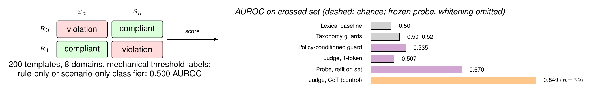

# Evaluating Rule Dependence in Compliance Detection Systems

Code and results for a short paper under double-blind review at WWW'27.

The paper asks whether a compliance guard's verdict actually depends on
the content of the rule it is given, or only on the fact that it was
given a rule and can cite it. A guard can name the correct clause while
its verdict stays almost entirely insensitive to what that clause says.
Most evaluation protocols only check the first part. This work tests the
second part directly, using counterfactual interventions on the rule
(deletion, permutation, substitution with an unrelated rule, and an exact
permissive-clause swap) and a crossed benchmark built from two rules and
two scenarios, so that neither text alone predicts the label.

Six detector types go through both tests. a policy-conditioned guard, two
fixed-taxonomy guards, a difference-of-means activation probe, a
training-free whitening detector, and a judge LLM run both forced-choice
and with chain-of-thought.

## The counterfactual audit

<p align="center">
  
</p>

Four interventions act on the rule while the scenario stays fixed. A
fifth removes the scenario instead, as a positive control. Every
intervention runs against every detector. Fixed-taxonomy guards and the
lexical baseline never receive the rule at all, so their insensitivity
here is architectural rather than something we measured.

## The crossed benchmark

<p align="center">
  
</p>

A single-clause substitution alone cannot tell apart a detector that uses
the relation between rule and scenario from one that has only learned
clause polarity, permissive versus prohibitive. The crossed design
removes that shortcut by construction. Each of 200 templates, across 8
regulatory domains, supplies two rules and two scenarios that cross into
four labelled cells, so neither text alone predicts the label. Detectors
that never receive the rule sit at chance here by design. The notable
result is that most detectors that do receive the rule barely clear
chance either, except a judge that is allowed to reason step by step.

## What maps to what

| Paper item | Script(s) | Results |
|---|---|---|
| Probe definition (Eq. 1), difference-of-means direction | `src/compliance/direction.py`, `metrics.py`, `splits.py` | n/a |
| Rule-ablation experiment (mean AUROC 0.9519, 0.9549, 0.9548 and 0.9554 under correct, no-rule, shuffled and wrong-domain rule, 0.5627 with the scenario removed, significance counts 0/20, 0/20, 0/20, 19/20) | `run_rule_ablation.py` (primary model), `run_rule_ablation_multi.py` (4 further models, 3B to 8B) | `results/rule_ablation/`, `results/rule_ablation_multi/` |
| Lexical-degeneracy check (Table 1, seven public compliance benchmarks) | `run_trivial_gauntlet.py` (OmniCompliance), `run_benchmark2_gauntlet.py` (DynaBench, SafePyramid), `run_benchmark3_gauntlet.py` + `benchmark3_data.py` (AIReg-Bench, CompliBench, FlexBench), `run_ifeval_probe.py` + `run_ifeval_activations.py` (IFEval) | `results/gauntlet/`, `results/benchmark2/`, `results/benchmark3/`, `results/ifeval/` |
| Crossed-benchmark construction and evaluation | `build_crossed_benchmark.py`, `run_crossed_eval.py`, `run_crossed_cot_judge.py`, `crossed_stats.py` (Wilson CIs, BH correction) | `results/crossed_benchmark/` |
| Cross-architecture search, 3 models each with 4 estimators (Llama-3.2-1B, Llama-3.1-8B and Qwen3-8B, each frozen, mean-difference, logistic and MLP) | `run_crossed_eval.py` | `results/crossed_benchmark/crossed_eval.json` |
| Whitening baseline (Rachmil et al.) | `run_rachmil_verify.py` | `results/rachmil_verify/` |
| GDPR worked example and clause-substitution protocol | `run_lpg.py`, `run_lpg_policy_control.py`, `run_lpg_removal_replication.py`, `run_worked_example_scores.py`, `run_example_candidate_search.py` | `results/competitors/lpg_4b_*.json`, `results/competitors/LPG_POLICY_CONTROL.json` |

All scripts above live under `scripts/`.

## Caveat on the headline numbers

The paper's lead claim is that one guard cites the governing clause
correctly in 90 to 95 percent of cases, yet flips its verdict in only 7.1
percent (13 of 182) of its originally flagged violations when the clause
is swapped for its exact permissive opposite. That specific aggregate is
not reproduced by a single file in this repository. `lpg_4b_*.json` and
`run_lpg_policy_control.py` cover a related rule-ablation protocol for the
same guard, with correct, shuffled, wrong-domain and no-policy conditions.
They are included as the closest available reproduction material, but
they do not total 182 cases or report a citation-accuracy percentage on
their own. Treat that specific number as not independently reproducible
from this repository alone.

## Setup

Needs Python 3.10 or later.

```bash
pip install -r requirements.txt
```

Each script under `scripts/` runs on its own, for example
`python scripts/run_rule_ablation.py --help`, and writes its output JSON
under `results/<experiment>/`, matching what is already included here.
Scripts that load a language model expect one visible CUDA GPU and will
download weights from the Hugging Face Hub on first run.

## Layout

`src/compliance/` holds the core probe implementation. `scripts/` holds
one runnable file per experiment. `results/` holds every result file the
paper cites, organised by experiment (`rule_ablation`,
`rule_ablation_multi`, `gauntlet`, `benchmark2`, `benchmark3`, `ifeval`,
`crossed_benchmark`, `rachmil_verify`, `competitors`). `docs/images/`
holds the two diagrams used above.
