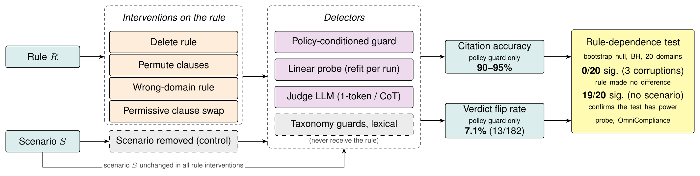

# Evaluating Rule Dependence in Compliance Detection Systems

**Anonymous code and results — submitted for double-blind review at WWW'27**

> Does a compliance guard's verdict actually depend on the content of the
> rule it is given, or only on the fact that it was given *a* rule (and can
> cite it)? This repository holds the counterfactual protocol, the crossed
> benchmark, and every result file behind the paper's tables and figures.

---

## Contents

- [What this paper tests](#what-this-paper-tests)
- [The counterfactual audit](#the-counterfactual-audit)
- [The crossed benchmark](#the-crossed-benchmark)
- [Repository map](#repository-map--paper-item--code--results)
- [A caveat we want reviewers to see](#a-caveat-we-want-reviewers-to-see)
- [Setup](#setup)
- [Repository structure](#repository-structure)

---

## What this paper tests

A citation and a decision are not the same thing. A guard can name the
clause its verdict relies on while that verdict stays almost entirely
insensitive to the clause's actual content — citing the rule and deciding
by it are logically separable behaviours, and most evaluation protocols
only ever check the first one.

We test the second one directly, with:

1. **Counterfactual interventions on the rule** — deletion, permutation,
   substitution with an unrelated rule, and an exact permissive-clause
   swap — while the scenario is held fixed.
2. **A confound-free crossed benchmark** — two rules crossed with two
   scenarios, so that neither the rule text nor the scenario text alone
   predicts the label.

Six detector types go through both tests: a policy-conditioned guard, two
fixed-taxonomy guards, a difference-of-means activation probe, a
training-free whitening detector, and a judge LLM run both forced-choice
and chain-of-thought.

## The counterfactual audit

<p align="center">
  
</p>

Four interventions act on the rule while the scenario is held fixed; a
fifth removes the scenario instead, as a positive control. Every
intervention is run against every detector. Fixed-taxonomy guards and the
lexical baseline never receive the rule at all, so they serve only as
baselines — their insensitivity is architectural, not a measured response.

## The crossed benchmark

<p align="center">
  
</p>

A single-clause substitution alone cannot rule out a detector that has
merely learned clause polarity (permissive vs. prohibitive) rather than
the relation between rule and scenario. The crossed design removes that
shortcut by construction: each of 200 templates, across 8 regulatory
domains, supplies two rules and two scenarios crossing into four labelled
cells, so neither text alone predicts the label. On this benchmark, every
detector that doesn't receive the rule sits at chance by design — the
interesting result is that the detectors that *do* receive the rule barely
clear it either, except a judge permitted to reason step by step.

## Repository map — paper item → code → results

| Paper item | Script(s) | Result files |
|---|---|---|
| Probe definition (Eq. 1), difference-of-means direction | `src/compliance/direction.py`, `src/compliance/metrics.py`, `src/compliance/splits.py` | — |
| Rule-ablation experiment — mean AUROC 0.9519 / 0.9549 / 0.9548 / 0.9554 under correct / no-rule / shuffled / wrong-domain-rule, 0.5627 with the scenario removed; significance counts 0/20, 0/20, 0/20, 19/20 | `scripts/run_rule_ablation.py` (primary model), `scripts/run_rule_ablation_multi.py` (replication across 4 further models, 3B–8B) | `results/rule_ablation/`, `results/rule_ablation_multi/` |
| Lexical-degeneracy check (Table 1 — seven public compliance benchmarks, policy-blind bag-of-words floor vs. the probe) | `scripts/run_trivial_gauntlet.py` (OmniCompliance), `scripts/run_benchmark2_gauntlet.py` (DynaBench, SafePyramid), `scripts/run_benchmark3_gauntlet.py` + `scripts/benchmark3_data.py` (AIReg-Bench, CompliBench, FlexBench), `scripts/run_ifeval_probe.py` + `scripts/run_ifeval_activations.py` (IFEval) | `results/gauntlet/`, `results/benchmark2/`, `results/benchmark3/`, `results/ifeval/` |
| Crossed-benchmark construction and evaluation (Figure above; every detector's AUROC / quadruple exact match) | `scripts/build_crossed_benchmark.py`, `scripts/run_crossed_eval.py`, `scripts/run_crossed_cot_judge.py`, `scripts/crossed_stats.py` (Wilson CIs, BH correction) | `results/crossed_benchmark/` (`crossed_pairs.json` is the benchmark itself; `crossed_eval.json` is every detector's score) |
| Cross-architecture search (3 models × 4 estimators: Llama-3.2-1B, Llama-3.1-8B, Qwen3-8B × frozen / mean-difference / logistic / MLP) | `scripts/run_crossed_eval.py` (stages `probe_results`, `probe_results_llama-3.1-8b-instruct`, `probe_results_qwen3-8b`) | `results/crossed_benchmark/crossed_eval.json` (keys `probe_results*`) |
| Whitening baseline (Rachmil et al.) | `scripts/run_rachmil_verify.py` | `results/rachmil_verify/` |
| GDPR worked example / counterfactual clause-substitution protocol on the policy-conditioned guard | `scripts/run_lpg.py`, `scripts/run_lpg_policy_control.py`, `scripts/run_lpg_removal_replication.py`, `scripts/run_worked_example_scores.py`, `scripts/run_example_candidate_search.py` | `results/competitors/lpg_4b_*.json`, `results/competitors/LPG_POLICY_CONTROL.json` |

## A caveat we want reviewers to see

The paper's lead claim — one guard cites the governing clause correctly in
90 to 95 percent of cases, yet flips its verdict in only 7.1 percent (13 of
182) of its originally-flagged violations when the clause is swapped for
its exact permissive opposite — is **not** reproduced by a single
aggregate file in this repository. `results/competitors/lpg_4b_*.json`
and `scripts/run_lpg_policy_control.py` cover a related rule-ablation
protocol (correct / shuffled / wrong-domain / no-policy conditions) for
the same guard, and are included as the closest available reproduction
material, but they do not by themselves total 182 cases or report a
citation-accuracy percentage. Treat that specific number as not yet
independently reproducible from this repository alone.

## Setup

Requires Python 3.10+.

```bash
pip install -r requirements.txt
```

Each script under `scripts/` runs standalone:

```bash
python scripts/<name>.py --help
```

and writes its output JSON under `results/<experiment>/`, matching the
files already included here. Scripts that load a language model expect a
single visible CUDA GPU and will download model weights from the Hugging
Face Hub on first run.

## Repository structure

```text
.
├── src/compliance/        core probe implementation (direction, metrics, splits)
├── scripts/                one runnable script per experiment
├── results/                 every result file referenced in the paper
│   ├── rule_ablation/        rule-deletion / shuffle / wrong-domain, primary model
│   ├── rule_ablation_multi/  same, replicated across 4 further models
│   ├── gauntlet/              OmniCompliance lexical-degeneracy check
│   ├── benchmark2/            DynaBench + SafePyramid lexical-degeneracy check
│   ├── benchmark3/            AIReg-Bench + CompliBench + FlexBench
│   ├── ifeval/                 IFEval lexical-degeneracy check
│   ├── crossed_benchmark/     the crossed benchmark itself + every detector's scores
│   ├── rachmil_verify/        whitening-detector baseline
│   └── competitors/           policy-conditioned guard (LPG) results
└── docs/images/                 diagrams used in this README
```
